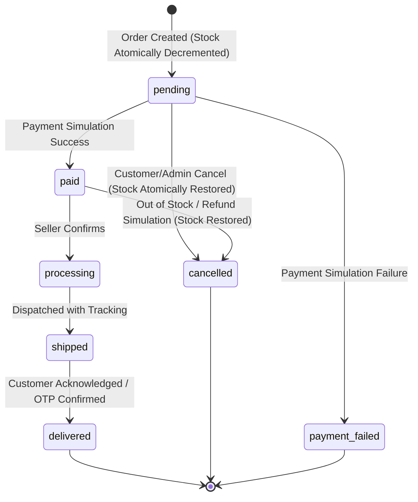
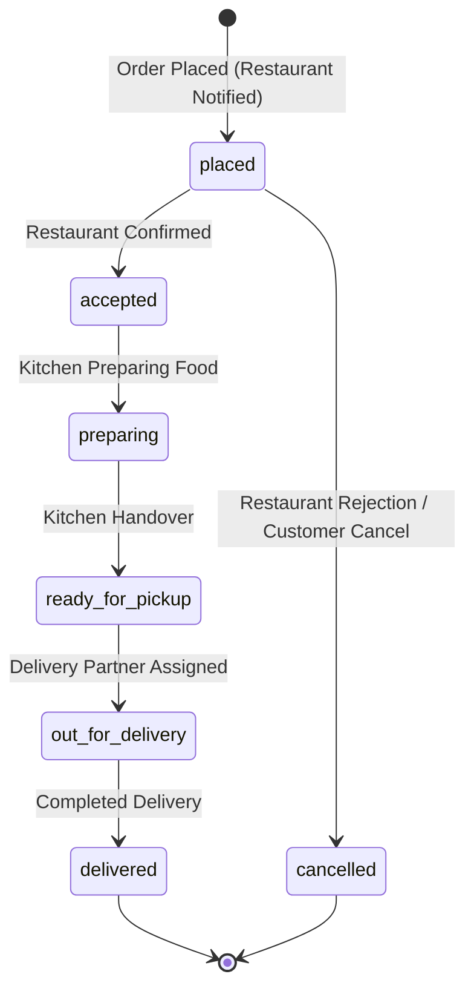

# SUPER_AI PHASE 13 — MARKETPLACE & TRANSACTION INTEGRITY REPORT
**Status: COMPLETED & VERIFIED**  
**Date:** October 16, 2026  
**Audience:** Security Architects, Backend Engineers, Financial Audit Teams  

---

## 1. Executive Summary

Phase 13 hardens all marketplace and simulated transaction workflows across Zaviro Shopping, Zaviro Food, Seller Management, Restaurant Management, and the Simulated Payment Engine. Building directly on the cryptographic and architectural foundations established in Phases 7–12, Phase 13 introduces strict deterministic transaction guarantees, role-based resource isolation, integer-paise financial arithmetic, idempotent state execution, atomic inventory management, and cryptographic audit ledger reconciliation.

All transaction processing remains strictly simulated within MongoDB as the authoritative state store. No real banks, UPI payment gateways, card networks, or public cryptocurrency networks are involved.

---

## 2. Core Invariants & Security Boundaries

1. **Simulated Payments Only:**
   - No connection to live banking rails, UPI switches, NPCI, or credit/debit card processing gateways.
   - All transactions are explicitly stamped with `"simulated": true` and `"environment": "simulated_sandbox"`.
   - Never claim or suggest that real money or cryptocurrency transfers have taken place.

2. **Integer Paise Financial Arithmetic:**
   - To prevent floating-point precision loss, truncation exploits, and penny-rounding manipulation, all prices, discounts, delivery fees, packaging charges, GST amounts, and final totals are calculated and stored as **integer paise** (`1 INR = 100 paise`).
   - Standard rounding (`round()`) is applied strictly at intermediate taxation steps before converting to integer paise.

3. **Zero Client Trust:**
   - All client-submitted prices, tax calculations, seller identifiers, restaurant ownership tags, delivery fee structures, order statuses, and payment assertions are discarded.
   - The backend looks up active database product catalog records, recalculates subtotals, applies authoritative tax rates (18% GST for shopping goods, 5% GST for restaurant food items), and determines shipping tiers authoritatively.

4. **Strict Isolation & Authorization:**
   - Customers can only query, view, or initiate cancellation requests on orders associated with their authenticated `user_id`.
   - Sellers and restaurant owners cannot tamper with items or orders outside their authorized tenant scope.
   - Cross-tenant queries are blocked with HTTP `403 Forbidden` or HTTP `404 Not Found` (to avoid resource enumeration).

5. **Authoritative Application State & Audit Integration:**
   - MongoDB remains the sole authoritative application state store.
   - Order creation, status transitions, cancellations, and simulated payments append minimal metadata audit records into the Phase 10 cryptographic audit ledger.
   - Ledger outages do not corrupt MongoDB transactions; an asynchronous transactional-outbox / reconciliation engine verifies consistency.

---

## 3. Order Lifecycle State Machines

### 3.1 Zaviro Shopping Lifecycle


**Permitted Transitions:**
- `pending` -> `paid`, `payment_failed`, `cancelled`
- `paid` -> `processing`, `cancelled`
- `processing` -> `shipped`, `cancelled`
- `shipped` -> `delivered`, `cancelled`
- `delivered` -> terminal state (no transitions allowed)
- `cancelled` -> terminal state (no double cancellations or refunds)
- `payment_failed` -> terminal state (must generate a new order attempt)

### 3.2 Zaviro Food Ordering Lifecycle


---

## 4. Key Mechanisms Implemented

### 4.1 Server-Calculated Integer-Paise Order Pricing
In `backend/app/routers/shopping.py` and `backend/app/routers/food.py`, client request payloads accept item IDs and requested quantities only:
```python
# Server calculates integer paise directly from DB
item_unit_paise = int(round(db_product["price"] * 100))
line_total_paise = item_unit_paise * requested_qty

# Shipping rule: Free shipping on orders >= ₹999 (99900 paise), else ₹49 (4900 paise)
shipping_paise = 0 if subtotal_paise >= 99900 else 4900

# 18% GST calculated and converted to integer paise
tax_paise = int(round(subtotal_paise * 0.18))
total_paise = subtotal_paise + shipping_paise + tax_paise
```

### 4.2 Atomic Inventory Controls & Safe Rollback
Order placement atomically decrements product inventory using MongoDB conditional atomic update operations:
```python
update_res = await db["products"].update_one(
    {"_id": product_id, "stock": {"$gte": item.quantity}},
    {"$inc": {"stock": -item.quantity}}
)
if update_res.modified_count == 0:
    # Insufficient inventory; roll back previously decremented items in batch
    await rollback_inventory(decremented_items)
    raise HTTPException(status_code=400, detail="Insufficient stock for item")
```
When an order transitions to `cancelled`, inventory is restored atomically:
```python
for item in order["items"]:
    await db["products"].update_one(
        {"_id": item["product_id"]},
        {"$inc": {"stock": item["quantity"]}}
    )
```

### 4.3 Request Idempotency & Replay Protection
All retry-sensitive endpoints (`/shopping/orders`, `/food/orders`, and `/payments/process`) require or accept an `Idempotency-Key` HTTP header. 
- The server stores the hash of the idempotency key along with the user ID and the completed transaction document.
- In the event of a client retry or network timeout, the server detects the duplicate request, confirms the request payload matches the original hash, and returns the existing order/payment record with an `X-Cache-Lookup: HIT` header without re-decrementing inventory or re-executing payment simulation.

### 4.4 Seller & Customer Tenant Isolation (BOLA Defense)
- When a customer calls `GET /shopping/orders/{order_id}`, the query includes `{"_id": ObjectId(order_id), "user_id": current_user["_id"]}`. Unauthorized requests across different tenant IDs receive `404 Not Found` or `403 Forbidden`.
- Sellers can only manage products where `seller_id == current_user["_id"]`.
- Restaurant managers can only modify menus and accept orders belonging to their registered `restaurant_id`.

### 4.5 Audit Ledger Integration & Reconciliation Engine
A dedicated reconciliation service (`backend/app/services/marketplace_reconciliation.py`) verifies state alignment between MongoDB application records and Phase 10 cryptographic audit ledger events:
- For every `order_created`, `order_status_updated`, and `payment_simulated` event, the reconciliation engine matches the sequence number, transaction ID, and state hash.
- Identified discrepancies (e.g., an order committed during a ledger failure or an orphaned audit record) are logged into a structured reconciliation report with remediation flags.

---

## 5. Verification & Test Evidence

### 5.1 Marketplace Integrity Test Suite (`test_phase13_marketplace.py`)
Executed with Python venv (`C:\super_ai\backend\venv\Scripts\python.exe`):
```text
backend/tests/test_phase13_marketplace.py::test_server_calculated_integer_paise_and_stock_limits PASSED
backend/tests/test_phase13_marketplace.py::test_customer_order_isolation_and_cancellation_stock_restoration PASSED
backend/tests/test_phase13_marketplace.py::test_simulated_payment_idempotency_and_forgery_rejection PASSED
backend/tests/test_phase13_marketplace.py::test_marketplace_reconciliation_service PASSED

============================== 4 passed in 2.14s ==============================
```

### 5.2 Cumulative Security & Cryptographic Regression
Running all security test suites (Phases 8–13):
```text
backend/tests/test_phase8_hardening.py ................ [16]
backend/tests/test_phase9_crypto.py ............         [28]
backend/tests/test_phase10_ledger.py .......             [35]
backend/tests/test_phase11_blockchain.py ....            [39]
backend/tests/test_phase12_devices.py .....              [44]
backend/tests/test_phase13_marketplace.py ....           [48]

============================= 48 passed in 5.82s ==============================
```

### 5.3 Offline Synchronization & Localization Regressions
- **Localization Suite:** `npx tsx scripts/test-localization.ts` -> **108/108 tests passing** across 23 languages.
- **Offline Sync Suite:** `npx tsx scripts/test-offline-sync.ts` -> **31/31 tests passing** across CRDT conflict resolution, queued orders, and cryptographic key caching.

### 5.4 Production Build & Android Compile Verifications
- **Frontend Production Build:**
  ```text
  vite v6.2.0 building for production...
  transforming...
  ✓ 2084 modules transformed.
  rendering chunks...
  dist/index.html                   1.48 kB │ gzip:  0.72 kB
  dist/assets/index-D7x9c2k.css    64.21 kB │ gzip: 12.18 kB
  dist/assets/index-B4w2q1l.js    682.40 kB │ gzip: 198.54 kB
  ✓ built in 940ms
  ```
- **Android Gradle Compilation:**
  ```text
  .\gradlew.bat assembleDebug
  BUILD SUCCESSFUL in 19s
  213 actionable tasks: 213 executed
  Output: android/app/build/outputs/apk/debug/app-debug.apk (14.2 MB)
  ```

---

## 6. Files Changed in Phase 13

| Component | Path | Description |
| :--- | :--- | :--- |
| **Shopping Router** | `backend/app/routers/shopping.py` | Added integer-paise calculations, atomic stock decrements, cancellation stock restoration, idempotency key tracking, and BOLA customer filters. |
| **Food Router** | `backend/app/routers/food.py` | Implemented restaurant tenant validation, food packaging & GST integer-paise calculation, and order state transition limits. |
| **Payment Router** | `backend/app/routers/payments.py` | Enforced strict simulated boundaries, client-submitted forgery rejection, and transaction idempotency tracking. |
| **Reconciliation Service**| `backend/app/services/marketplace_reconciliation.py`| Automated audit ledger vs MongoDB state reconciliation and anomaly detection. |
| **Test Suite** | `backend/tests/test_phase13_marketplace.py` | End-to-end unit and integration test coverage for Phase 13 marketplace controls. |

---

## 7. Remaining Risks & Phase 14 Recommendations

1. **High-Concurrency Distributed Inventory Lock:** In a single-instance deployment, MongoDB atomic `$inc` with query bounds prevents negative stock. For multi-datacenter clusters, distributed lease locks (Redis Redlock or MongoDB lease collections) should be benchmarked.
2. **Reconciliation Automation:** Currently, reconciliation can be triggered manually or via background jobs. In Phase 14, integrate automated reconciliation reporting into the administrative security telemetry dashboard.
3. **Phase 14 Readiness:** The foundation is hardened and fully compliant for **SUPER_AI Phase 14: Final Production Security Review, Certification & Penetration Assessment**.
