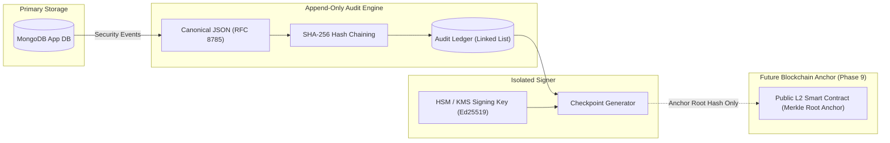

# SUPER_AI — Security Remediation Plan & Blockchain Readiness Architecture
**Document Version:** 1.0 (Phase 7 Audit & Baseline)  
**Root Path:** `C:\super_ai`  
**Target:** SUPER_AI Sovereign Indic Super App  

---

## 1. Prioritized Remediation Roadmap

The remediation strategy balances immediate vulnerability mitigation with long-term architectural hardening.

| Phase | Priority | Focus Area | Status / Target |
| :--- | :--- | :--- | :--- |
| **Phase 7 (Immediate)** | **P0 / P1** | • Fix BOLA on private video streaming (SEC-01).<br>• Enforce deactivated user rejection in dependencies (SEC-02).<br>• Inject defensive HTTP security response headers (SEC-03).<br>• Fast-fail guard against default JWT secret in production (SEC-04).<br>• Lock fixes with automated regression tests. | **COMPLETED & VERIFIED** |
| **Phase 8 (Hardening)** | **P2** | • Migrate in-memory rate limiting to centralized Redis store (SEC-05).<br>• Implement access-token revocation JTI blacklist (SEC-06).<br>• Update Capacitor CLI dependency tree to patch transitive `uuid` advisory (SEC-07).<br>• Add anti-virus / malicious file heuristic scanning for uploaded media. | Planned for Phase 8 |
| **Phase 9+ (Architecture)** | **P3** | • Deploy private append-only audit ledger (Blockchain Readiness Design).<br>• Transition to WebAuthn / Passkeys for passwordless authentication.<br>• Implement IndexedDB encrypted envelope storage on mobile devices. | Architectural Roadmap |

---

## 2. Completed Phase 7 Patches & Regression Verification

### 2.1 Patch 1: BOLA Resolution in Video Streaming (SEC-01)
- **File:** `backend/app/api/routes/videos.py`
- **Change:** Injected `current_user: Optional[Dict[str, Any]] = Depends(get_optional_current_user)` into `stream_video`. If `video.get("visibility") == "private"`, verified caller ownership.
- **API Compatibility:** 100% backward compatible. Legitimate creators continue to stream their private content seamlessly; public videos remain streamable without authentication.
- **Verification:** `tests/test_security_audit.py::test_private_video_streaming_authorization` passes.

### 2.2 Patch 2: Deactivated Account Access Guard (SEC-02)
- **File:** `backend/app/api/deps.py`
- **Change:** Added check in `get_current_user`:
  ```python
  if not user.get("is_active", True):
      raise HTTPException(status_code=status.HTTP_403_FORBIDDEN, detail="Account is deactivated")
  ```
  and required `user.get("is_active", True)` in `get_optional_current_user`.
- **API Compatibility:** Active accounts experience zero difference. Suspended/deactivated accounts are immediately blocked from protected APIs.
- **Verification:** `tests/test_security_audit.py::test_deactivated_user_token_rejected` passes.

### 2.3 Patch 3: Standard Defensive HTTP Headers (SEC-03)
- **File:** `backend/app/main.py`
- **Change:** Added HTTP middleware injecting `X-Content-Type-Options: nosniff`, `X-Frame-Options: DENY`, `Referrer-Policy: strict-origin-when-cross-origin`, `Permissions-Policy: geolocation=(), microphone=(), camera=()`, and `X-XSS-Protection: 0`.
- **API Compatibility:** Fully compliant with modern browsers and mobile WebViews.
- **Verification:** `tests/test_security_audit.py::test_security_headers_present` passes.

### 2.4 Patch 4: Production Configuration Guard (SEC-04)
- **File:** `backend/app/main.py`
- **Change:** Lifespan startup check raises `RuntimeError` if running with default secret in `production`, or logs warning in `development`.
- **API Compatibility:** Zero impact on development environments; prevents catastrophic deployment misconfiguration in production.

---

## 3. Blockchain Readiness Architecture Specification

> **Phase 7 Architectural Mandate:** Phase 7 is an audit and baseline design phase. No live smart contracts are deployed, no blockchain gas fees are incurred, and no live wallets are created in this phase.

### 3.1 Architectural Overview
The audit ledger is designed as a **hybrid verifiable architecture**:
1. **Primary Database:** MongoDB remains the primary, high-throughput transactional database.
2. **Audit Ledger:** Security-critical events are recorded sequentially into a local append-only cryptographic ledger.
3. **Cryptographic Chaining:** Each ledger entry is hashed using SHA-256 and chained to the previous record's hash (`previous_hash`).
4. **Periodic Checkpoints:** Merkle root checkpoints are signed by an isolated signing agent holding an Ed25519 private key outside the application database.
5. **Future Anchor:** Signed checkpoints can be anchored to a public blockchain (e.g., Polygon, Arbitrum, or Ethereum L2) for decentralized timestamping without leaking user data.



---

### 3.2 Audit Event Whitelist & Strict Zero-PII Guarantee

#### Whitelisted Event Types:
- `AUTH_LOGIN_SUCCESS` / `AUTH_LOGIN_FAILURE`
- `AUTH_PASSWORD_RESET`
- `ACCOUNT_DEACTIVATED` / `ACCOUNT_DELETED`
- `ORDER_CREATED` / `ORDER_CANCELLED`
- `PAYMENT_STATE_CHANGED`
- `SELLER_STATUS_CHANGED`
- `ADMIN_ROLE_GRANTED` / `ADMIN_ROLE_REVOKED`
- `SECURITY_VIOLATION_BLOCKED`

#### Strictly Prohibited Fields (Never Recorded in Audit Ledger):
To comply with global privacy standards (GDPR, India's DPDP Act 2023) and guarantee Zero-PII:
- **NO** plain or hashed passwords.
- **NO** JWTs, refresh tokens, session keys, or API secrets.
- **NO** personal names, email addresses, phone numbers, or physical delivery addresses.
- **NO** plain User IDs or Customer IDs (use HMAC-derived pseudonyms keyed per audit epoch).
- **NO** chat message bodies, video binaries, or post text.
- **NO** credit/debit card numbers, UPI VPA handles, or bank accounts.

---

### 3.3 Canonical Event Schema & Hashing Mechanics

Events must use **RFC 8785 (JSON Canonicalization Scheme - JCS)** to guarantee byte-level deterministic serialization across diverse platforms.

```json
{
  "sequence_number": 10452,
  "timestamp_utc": "2026-10-15T18:00:00.000Z",
  "event_type": "AUTH_LOGIN_SUCCESS",
  "epoch_id": "2026-Q4",
  "actor_pseudonym_hash": "a1b2c3d4e5f6... (HMAC-SHA256)",
  "resource_type": "USER_SESSION",
  "resource_id_hash": "e7f8a9b0c1d2...",
  "metadata": {
    "action": "LOGIN",
    "status": "SUCCESS",
    "ip_prefix": "192.168.0.0/16"
  },
  "previous_hash": "5e884898da28047151d0e56f8dc6292773603d0d6aabbdd62a11ef721d1542d8",
  "record_hash": "4b227777d4dd1fc61c6f884f48641d02b4d121d3fd328cb08b5531fcacdabf8a"
}
```

#### Hash Calculation Formula:
$$\text{record\_hash} = \text{SHA-256}(\text{JCS}(\text{sequence\_number} + \text{timestamp} + \text{event\_type} + \text{actor\_pseudonym\_hash} + \text{resource\_id\_hash} + \text{metadata} + \text{previous\_hash}))$$

---

### 3.4 Key Management & Isolation Architecture

1. **Key Generation:** Ed25519 asymmetric key pair generated inside a dedicated Hardware Security Module (HSM) or cloud KMS (Google Cloud KMS / AWS KMS).
2. **Access Isolation:** The FastAPI application server has **write-only** access to append raw event entries, but **ZERO** access to the private signing key. Checkpoint signing is executed by an isolated, air-gapped background signing service.
3. **Key Rotation:** Audit signing keys rotate quarterly. Each epoch signs the root hash of the preceding epoch during rotation.
4. **Revocation & Compromise:** If an epoch signing key is suspected of compromise, the epoch is sealed immediately, a revocation statement is signed by the master offline recovery key, and a new epoch is initiated.

---

### 3.5 Verification Engine Specification

An independent verification script (`verify_audit_ledger.py`) validates the ledger offline:
1. **Sequence Continuity:** Verifies that $\text{sequence\_number}_{n} = \text{sequence\_number}_{n-1} + 1$.
2. **Hash Chain Integrity:** Recalculates $\text{SHA-256}(\text{JCS}(\text{event}_n))$ and verifies that it equals $\text{record\_hash}_n$, and that $\text{previous\_hash}_{n} = \text{record\_hash}_{n-1}$.
3. **Signature Verification:** Verifies the Ed25519 signature on every periodic checkpoint against the published public key.
4. **Tamper Detection:** Detects altered records, deleted entries, reordered rows, or signature mismatches in $\mathcal{O}(N)$ linear time.

---

### 3.6 Failure Handling & Resilience Policies

- **Ledger Storage Failure:** If the local ledger disk becomes full or unwritable, the application server enters a fail-safe degraded state: authentication and financial mutations are rejected (`fail-closed`), while read operations remain operational.
- **Blockchain Unavailability (Future Phase):** If the external public blockchain network experiences high gas fees or downtime, local checkpoint signing continues uninterrupted. Checkpoint hashes are queued in an outbound anchor spool and broadcast once the network stabilizes. Local tamper-evidence remains 100% intact even without the public chain.

---

### 3.7 Privacy & "Right to be Forgotten" Compliance

Under India's DPDP Act and GDPR Article 17, users have the right to request erasure of their personal data.
- Because the audit ledger contains **strictly zero PII** and all actor/resource references are one-way HMAC pseudonym hashes, deleting a user from MongoDB leaves **no identifiable trace** in the audit ledger.
- When a user account is deleted, the user's personal HMAC pepper can be destroyed, rendering the historic pseudonym hashes mathematically impossible to link to any natural person.

---

## 4. Phase 8 Security Hardening Action Items

1. **Redis Centralized Rate Limiter:** Replace in-memory dictionaries in `backend/app/core/rate_limit.py` with Redis token-bucket algorithms.
2. **Token Blacklist Service:** Implement fast in-memory JTI lookup for immediate revocation of access tokens on logout.
3. **Capacitor Dependency Clean-up:** Execute targeted dependency tree resolution to address the development-time `uuid` notice in `@capacitor/cli`.
4. **ClamAV Container Integration:** Introduce asynchronous antivirus container inspection for media uploads prior to streaming availability.
