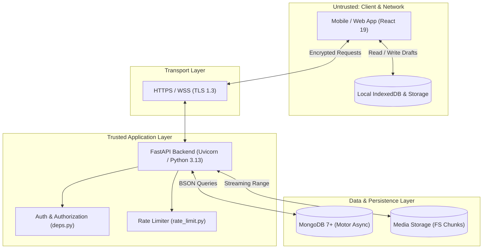
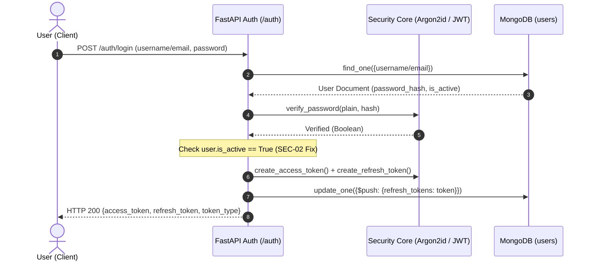
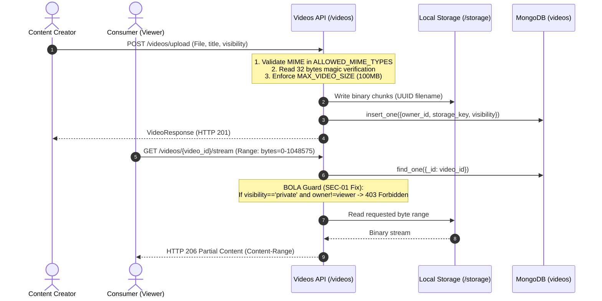
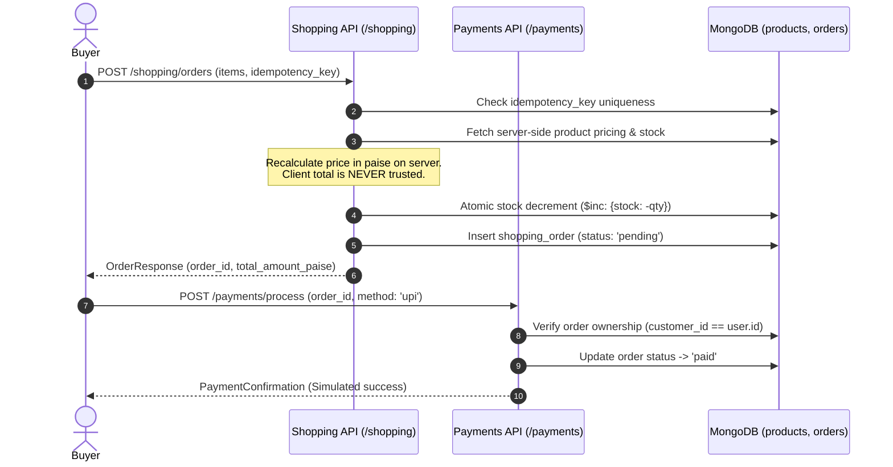
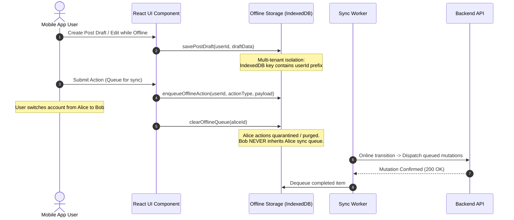
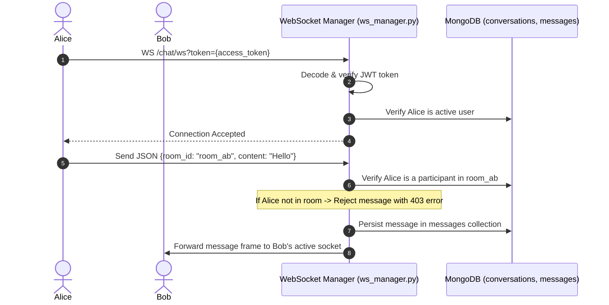

# SUPER_AI — Security Threat Model
**Methodology:** STRIDE (Spoofing, Tampering, Repudiation, Information Disclosure, Denial of Service, Elevation of Privilege)  
**Target:** SUPER_AI Sovereign Indic Super App (Web, Android, API, Database, Offline Engine)  
**Document Version:** 1.0 (Phase 7 Audit & Baseline)

---

## 1. System Architecture & Trust Boundaries

SUPER_AI processes multi-tenant user requests across six distinct trust zones:
1. **Zone 1: Client Runtime (Untrusted).** React 19 SPA running in untrusted mobile WebViews (Capacitor Android) and standard desktop browsers.
2. **Zone 2: Local Client Storage (Semi-Trusted).** Browser `localStorage` and `IndexedDB` (`super_ai_offline_db_v1`). Subject to physical device theft or client-side scripts.
3. **Zone 3: Network Transport (Untrusted).** Public Internet / Cellular networks. Protected via TLS 1.3 / HTTPS and WSS.
4. **Zone 4: Application Gateway & API Server (Trusted).** FastAPI ASGI backend handling authentication, authorization, business rules, and input sanitization.
5. **Zone 5: Primary Database (High Trust).** MongoDB database holding tenant accounts, posts, orders, videos, and chats.
6. **Zone 6: Local Media Storage (High Trust).** Local filesystem directory holding binary image and video chunks.

---

## 2. Threat Actors Profile

| Actor Profile | Description & Capabilities | Motivation | Typical Vectors |
| :--- | :--- | :--- | :--- |
| **Opportunistic Attacker** | External Internet user with automated scanners and scripts. | Reconnaissance, data harvesting, vandalism. | Brute force login, open redirect scans, automated XSS probes, IDOR enumeration. |
| **Malicious Authenticated User** | Legitimately registered tenant attempting to access other users' data. | Financial gain, privacy breach, stalking. | BOLA parameter tampering (`video_id`, `order_id`), unauthorized API calls, fake reports. |
| **Rogue Merchant / Seller** | Onboarded seller or restaurant attempting to manipulate catalog or pricing. | Profit skimming, stock spoofing. | Client-side price tampering, fake order state transitions, inventory inflation. |
| **Local Device Attacker** | Unauthorized person with physical or root access to user's mobile device. | Session hijacking, draft theft. | Inspection of unencrypted IndexedDB, SQLite extraction, token theft from memory. |
| **Compromised Admin** | Administrator credential stolen or rogue employee. | System compromise, bulk exfiltration. | Direct database modification, log alteration, privilege escalation. |

---

## 3. Data Flow Diagrams & Threat Analysis

### 3.1 Data Flow 1: Authentication & Token Lifecycle

#### STRIDE Analysis for Authentication:
- **Spoofing:** Attacker attempts credential stuffing or password brute force. *Mitigation:* Argon2id hashing, IP/Username rate limiting (`auth_rate_limiter`), JWT signature verification.
- **Tampering:** Attacker alters JWT claims (`sub`, `roles`). *Mitigation:* HMAC-SHA256 signature verification with secret key validation; fast-fail in production (SEC-04).
- **Repudiation:** User denies login or password change. *Mitigation:* Structured audit logging of authentication events with client IP and timestamps.
- **Information Disclosure:** Tokens or hashed passwords leaked via responses or logs. *Mitigation:* Strict Pydantic response models (`UserResponse`) redacting `password_hash` and `refresh_tokens`.
- **Denial of Service:** Massive Argon2id hash computation requests. *Mitigation:* In-flight request throttling before Argon2 evaluation.
- **Elevation of Privilege:** Deactivated user maintains access via old token. *Mitigation:* `get_current_user` enforces `is_active` check on every authenticated request (SEC-02).

---

### 3.2 Data Flow 2: Media Upload & Streaming

#### STRIDE Analysis for Media:
- **Spoofing / Tampering:** Attacker uploads executable or HTML with `.mp4` extension. *Mitigation:* Dual validation of Content-Type header AND binary magic bytes (`verify_media_magic`).
- **Information Disclosure:** Unauthenticated user accesses private video stream. *Mitigation:* Resolved via SEC-01 fix in `stream_video` enforcing owner ID comparison against `current_user`.
- **Path Traversal:** Filename manipulation (`../../etc/passwd`). *Mitigation:* All storage keys generated via server-side `uuid.uuid4().hex` + validated extension; original user filename never used as disk path.
- **Denial of Service:** Giant file upload crashing disk/RAM. *Mitigation:* Streamed chunked writing with hard ceiling of 100MB (`MAX_VIDEO_SIZE`).

---

### 3.3 Data Flow 3: Marketplace Orders & Simulated Payments

#### STRIDE Analysis for Marketplace:
- **Tampering (Price Spoofing):** Client modifies order total from ₹1000 to ₹1 in payload. *Mitigation:* Server ignores client total and recalculates sum of `product.price_paise * item.quantity` directly from MongoDB catalog.
- **Tampering (Stock Race Condition):** Two users buy last item simultaneously. *Mitigation:* Atomic MongoDB `$inc` query with conditional filter `stock: {$gte: qty}`.
- **Repudiation (Order Replay):** Duplicate network requests generate multiple charges. *Mitigation:* Mandatory server-side `idempotency_key` indexed with unique constraint.
- **Elevation of Privilege / BOLA:** User queries or cancels order belonging to another customer. *Mitigation:* `shopping.py` restricts order retrieval strictly to `order["customer_id"] == current_user["id"]` or authorized merchant.

---

### 3.4 Data Flow 4: Offline Draft & Sync Queue

#### STRIDE Analysis for Offline Engine:
- **Cross-User Data Leakage (Spoofing / Elevation):** User A logs out on shared phone; User B logs in and transmits User A's pending actions. *Mitigation:* Verified in Phase 6 offline tests: queues are partitioned by `userId`, and `OfflineSyncContext` purges/quarantines queues upon account switch.
- **Tampering (Duplicate Orders):** User queues order or payment while offline and replays when reconnected. *Mitigation:* Order creation and payment processing are explicitly prohibited from offline enqueueing (`isActionQueuable` check).
- **Information Disclosure:** Unencrypted drafts in IndexedDB. *Mitigation:* Addressed in documentation (SEC-08); application clears sensitive cached data on explicit logout.

---

### 3.5 Data Flow 5: Real-time WebSocket Chat

#### STRIDE Analysis for WebSockets:
- **Spoofing:** Attacker connects to WebSocket without credentials. *Mitigation:* Mandatory token handshake query parameter decoded before connection acceptance.
- **Information Disclosure (Eavesdropping):** Attacker joins arbitrary room ID to spy on conversations. *Mitigation:* `ws_manager.py` verifies caller ID against conversation `participants` array before routing messages.
- **Denial of Service (Connection Exhaustion):** Attacker opens thousands of concurrent sockets. *Mitigation:* Per-user connection cap enforced by WebSocket manager.

---

## 4. STRIDE Threat Catalog & Mitigation Matrix

| Threat Category | Threat Description | Vulnerable Scenario | Implemented Mitigation | Residual Risk |
| :--- | :--- | :--- | :--- | :--- |
| **Spoofing** | Forged JWT access token. | Attacker attempts to forge token using default development secret. | SEC-04: Lifespan enforces non-default key in production. Argon2id for password verification. | Low (Secret key security dependent on operational hygiene). |
| **Spoofing** | WebSocket unauthorized connection. | Malicious client attempts socket connection without credentials. | JWT token required on query parameter and validated on connection. | Low (Ephemeral token param in URL; recommend header/cookie in Phase 8). |
| **Tampering** | File upload payload disguise. | Malicious script uploaded disguised as PNG/MP4. | Binary magic bytes and MIME validation enforced in `social.py` and `videos.py`. | Low (Advanced polyglot files; recommend ClamAV in Phase 8). |
| **Tampering** | Client-side price tampering. | Malicious buyer alters item price in order request. | Server ignores client amount and recalculates total from catalog. | None (Enforced server-side). |
| **Repudiation** | Replayed order or charge. | Network latency triggers duplicate submission. | Server-side idempotency keys with unique indexes. | None. |
| **Information Disclosure** | BOLA on private video streaming. | Attacker accesses private video URL directly. | SEC-01: Ownership check enforced in `stream_video`. | None. |
| **Information Disclosure** | Deactivated user accesses profile. | Soft-deleted user token remains valid. | SEC-02: `is_active` checked on every authenticated request. | None. |
| **Denial of Service** | Social post / comment spam. | Automated bot spams posts and comments. | Rate limiters (`rate_limit.py`) enforce limits per user ID. | Medium (In-memory limiter per process; Phase 8 Redis required). |
| **Elevation of Privilege** | Normal user accesses seller/admin controls. | Regular user submits seller-only product updates. | Strict role-based and ownership checks on seller endpoints. | None. |

---

## 5. Security Conclusions

The SUPER_AI architecture adheres to defense-in-depth principles across its core subsystems. The threat model confirms that the primary attack surfaces (BOLA on streaming, deactivated user token validity, client-side price tampering, and offline queue contamination) are either fully remediated or bounded by existing server-side controls.
