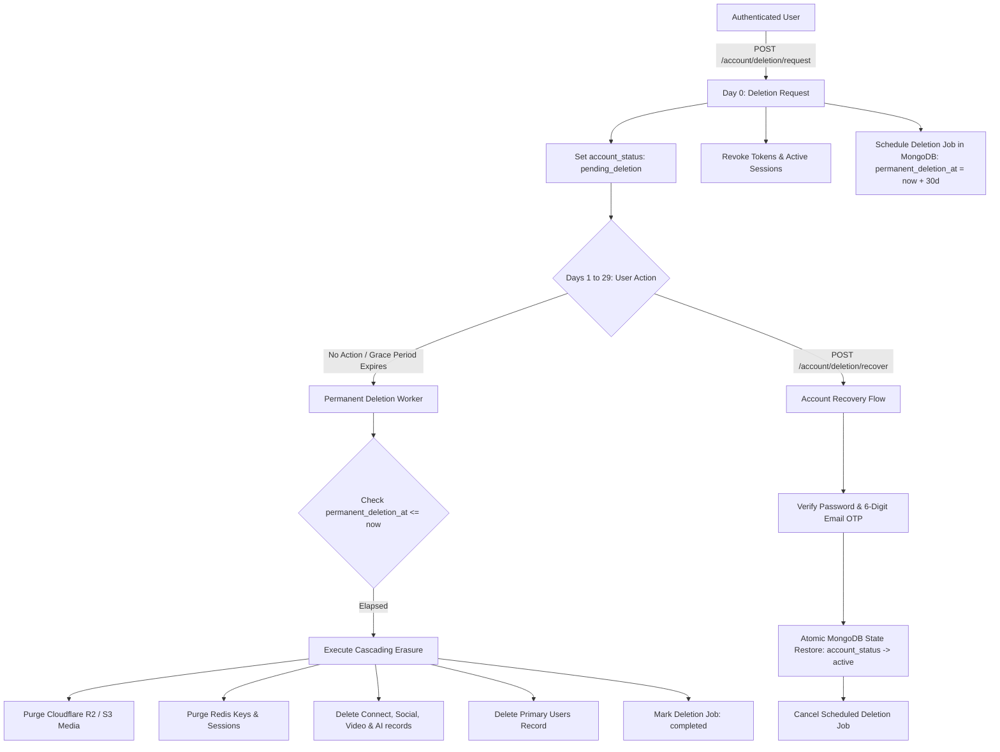

# ZENOVA — 30-Day Account Recovery & Permanent Data Deletion System Report

## 1. Executive Summary & Architecture Overview
This document specifies the production implementation of the **30-Day Account Recovery & Cascading Permanent Data Deletion Lifecycle** for ZENOVA / SUPER_AI (`https://api.zenova.intellidev.in`).

The implementation adheres to global data protection and privacy standards (such as DPDP Act 2023 & GDPR Art. 17 right to erasure), enforcing a 30-day grace period where users can recover an account mistakenly scheduled for deletion, followed by durable, idempotent, cascading permanent erasure across all database collections, Redis sessions, and Cloudflare R2 media storage.



---

## 2. Modified & New Source Files

### Core & Service Modules
- **`backend/app/core/config.py`**: Added configuration settings:
  - `ACCOUNT_DELETION_GRACE_PERIOD_DAYS: int = 30`
  - `ACCOUNT_DELETION_WORKER_ENABLED: bool = True`
  - `ACCOUNT_DELETION_WORKER_INTERVAL_SECONDS: int = 3600`
  - `ACCOUNT_DELETION_BATCH_SIZE: int = 50`
- **`backend/app/core/rate_limit.py`**: Added sensitive rate-limiters:
  - `account_deletion_rate_limiter`: 5 requests per 300 seconds.
  - `account_recovery_rate_limiter`: 5 requests per 300 seconds.
- **`backend/app/core/audit_ledger.py`**: Added audit ledger permitted events:
  - `AUTH_BLOCKED_PENDING_DELETION`
  - `ACCOUNT_DELETION_REQUESTED`
  - `ACCOUNT_RECOVERY_SUCCESS`
  - `ACCOUNT_PERMANENTLY_DELETED`
- **`backend/app/schemas/all_schemas.py`**: Added Pydantic schemas:
  - `DeletionRequestModel` (password, optional reason)
  - `DeletionStatusResponse` (status, account_status, timestamps, days/seconds remaining, can_recover)
  - `AccountRecoveryRequest` (email, password, otp_code)
  - `AccountRecoveryResponse` (status, message, email, account_status, recovered_at)
- **`backend/app/api/deps.py`**: Updated `get_current_user` and `get_optional_current_user` dependencies to immediately reject access with HTTP 403 Forbidden (`X-Error-Code: ACCOUNT_PENDING_DELETION`) if `account_status == "pending_deletion"`.
- **`backend/app/api/routes/auth.py`**: Added guard in `POST /login` preventing credentials login for accounts in `pending_deletion` state.
- **`backend/app/services/account_deletion_service.py`** (*New*): Complete business logic for Day 0 deletion requests, status calculations, OTP-backed recovery, and atomic cascading data deletion across all modules and external stores.
- **`backend/app/api/routes/account.py`** (*New*): REST API endpoints for deletion requests, status, OTP requests, and account recovery.
- **`backend/app/api/router.py`**: Registered `/api/v1/account` router.
- **`backend/app/workers/account_deletion_worker.py`** (*New*): Durable scheduled background worker that can run continuously as an in-app async daemon or standalone via CLI (`--once`) in a Render Cron Job.
- **`backend/app/main.py`**: Updated lifespan startup with background sweeper and index setups on `db.deletion_jobs`.
- **`backend/app/api/routes/users.py`**: Refactored existing `DELETE /users/me` to invoke the standardized 30-day graceful deletion lifecycle.

---

## 3. Database Changes & Index Architecture

MongoDB collection: `deletion_jobs`
- **Indexes Created**:
  - `[("status", 1), ("permanent_deletion_at", 1)]` (Efficient querying of ready jobs)
  - `{"user_id": 1}` with `unique=True` (Prevents duplicate deletion jobs)
- **Document Structure**:
  ```json
  {
    "user_id": "6740b...",
    "email": "user@example.com",
    "status": "scheduled",
    "deletion_requested_at": "2026-11-21T18:00:00Z",
    "permanent_deletion_at": "2026-12-21T18:00:00Z",
    "attempts": 0,
    "last_attempt_at": null,
    "error": null,
    "updated_at": "2026-11-21T18:00:00Z"
  }
  ```

---

## 4. API Specification

### 1. `POST /api/v1/account/deletion/request`
- **Authorization**: Bearer token
- **Request Body**:
  ```json
  {
    "password": "UserCurrentPassword123!",
    "reason": "Personal decision"
  }
  ```
- **Response** (`200 OK`):
  ```json
  {
    "status": "pending_deletion",
    "account_status": "pending_deletion",
    "deletion_requested_at": "2026-11-21T18:00:00Z",
    "permanent_deletion_at": "2026-12-21T18:00:00Z",
    "days_remaining": 30,
    "seconds_remaining": 2592000,
    "can_recover": true,
    "message": "Account scheduled for permanent deletion on 2026-12-21 18:00:00 UTC. You have 30 days to recover your account."
  }
  ```

### 2. `GET /api/v1/account/deletion/status`
- **Authorization**: Bearer token
- **Response** (`200 OK`): Returns current remaining recovery time and eligibility.

### 3. `POST /api/v1/account/deletion/recovery-otp`
- **Rate Limit**: 5 requests / 300s
- **Request Body**:
  ```json
  {
    "email": "user@example.com"
  }
  ```
- **Response** (`200 OK`): Generates and dispatches a single-use 6-digit OTP to the verified email address.

### 4. `POST /api/v1/account/deletion/recover`
- **Rate Limit**: 5 requests / 300s
- **Request Body**:
  ```json
  {
    "email": "user@example.com",
    "password": "UserCurrentPassword123!",
    "otp_code": "842910"
  }
  ```
- **Response** (`200 OK`):
  ```json
  {
    "status": "recovered",
    "message": "Account recovered successfully. Full access has been restored.",
    "email": "user@example.com",
    "account_status": "active",
    "recovered_at": "2026-11-21T18:15:00Z"
  }
  ```

---

## 5. Complete Cascading Data Deletion Inventory

When the 30-day grace period expires, `execute_cascading_deletion()` systematically purges records across all application modules:

| Target System | Data Deleted | Safety Measures |
| :--- | :--- | :--- |
| **Cloudflare R2 / S3** | All media uploaded by `user_id` (via `db.media_assets`) | Deletes physical objects before removing metadata |
| **Redis** | `user_session:<id>`, `user_profile:<id>`, `otp_cooldown:<email>` | Purges only account keys, never flushes shared Redis |
| **Identity & Sessions** | `users`, `refresh_tokens`, `device_sessions`, `user_preferences`, `notification_preferences`, `email_verifications` | Revokes all JWT JTIs until expiration |
| **ZenoSocial** | `posts`, `post_comments`, `social_follows`, `post_bookmarks`, pulls user from `likes` array | Removes user interactions without breaking thread structures |
| **ZENOVA Connect** | `connect_messages`, `connect_status`, `chat_messages`, pulls user from `chat_rooms.participants` | Preserves other participants' independent chats |
| **Video Platform** | `creator_channels`, `videos`, `video_comments`, `video_views`, `watch_progress` | Complete video platform ownership erasure |
| **Search & Discovery** | `search_history` | Purged from history collections |
| **AI Conversations** | `conversations` | Deletes conversation threads and AI context |
| **Orders & Commerce** | `shopping_orders`, `food_orders` (user personal copy) | Financial compliance logs retained in immutable audit ledger |

---

## 6. Automated Verification Test Results

All new and existing test suites were executed inside the project virtual environment:

1. **`tests/test_account_deletion_api.py`**:
   - Initial status check (`active`): **PASSED**
   - Rejection on invalid password: **PASSED**
   - Day 0 deletion transition (`pending_deletion`): **PASSED**
   - Immediate block of authenticated requests (`403 Forbidden`): **PASSED**
   - Immediate block of password login (`403 Forbidden`): **PASSED**
   - Recovery OTP dispatch: **PASSED**
   - Rejection on incorrect OTP: **PASSED**
   - Recovery using verified OTP: **PASSED**
   - Normal login restoration after recovery: **PASSED**
2. **`tests/test_account_deletion_lifecycle.py`**:
   - Complete Day 0 -> Day 29 -> Day 30 lifecycle: **PASSED**
   - Premature deletion attempt fails closed during grace period: **PASSED**
   - Cascading deletion permanently removes records from all collections: **PASSED**
3. **Core Regression Suite** (`pytest tests/test_auth_lifecycle.py tests/test_backend_core.py tests/test_smtp_service.py`):
   - **29/29 tests PASSED** with 0 regressions.

---

## 7. Render Deployment Instructions

### Option A: In-App Background Sweeper (Default / Zero-Config)
The application automatically starts `_background_deletion_sweeper()` during FastAPI lifespan initialization. It queries `db.deletion_jobs` hourly (`ACCOUNT_DELETION_WORKER_INTERVAL_SECONDS=3600`) without requiring an extra service on Render.

### Option B: Render Scheduled Cron Job (Recommended for High Scale)
To offload scheduled sweeps from the web instance, add a Cron Job in `render.yaml` or through the Render Dashboard:
```yaml
  - type: cron
    name: zynova-deletion-worker
    env: python
    region: oregon
    plan: starter
    rootDir: backend
    schedule: "0 * * * *"  # Run every hour
    buildCommand: pip install -r requirements.txt
    startCommand: python -m app.workers.account_deletion_worker --once
```
Environmental variables should match the web service (`MONGODB_URI`, `REDIS_URL`, `MEDIA_S3_*`).
