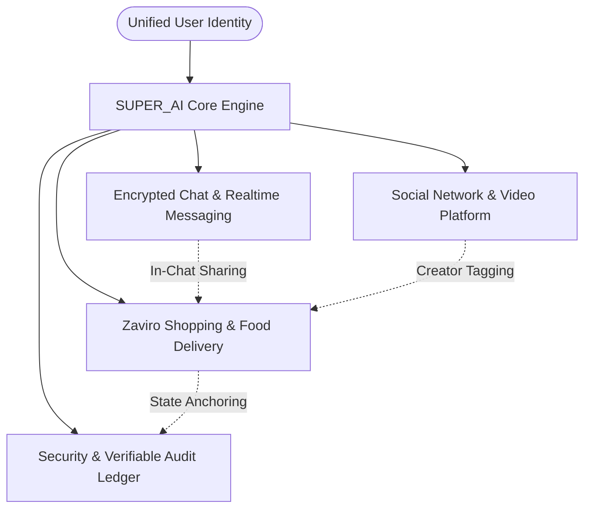

# 02 — PRODUCT VISION & THE UNIFIED SUPER-APP PARADIGM

## 1. The Context: Fragmented App Fatigue
Today's digital ecosystem is characterized by extreme specialization. A typical smartphone user maintains:
- 1–2 Messaging apps (e.g., WhatsApp, Telegram)
- 2–3 Social media & short-video apps (e.g., Instagram, YouTube, X)
- 2–3 E-commerce & quick-commerce apps (e.g., Amazon, Flipkart, Blinkit)
- 1–2 Food delivery & dine-in apps (e.g., Zomato, Swiggy)

### Why Users Accept This Fragmentation Today:
1. **Vertical Depth:** Specialized applications invest millions into dedicated logistics tracking, custom video encoders, or algorithmic content feeds.
2. **Organizational Silos:** Different corporate entities optimize for their own walled gardens, monetization models, and user lock-in.

### The Hidden Costs to Consumers:
- **System Resource Drain:** Multiple concurrent background daemons consume excessive RAM, battery, and background cellular data.
- **Privacy Surface Expansion:** Each independent app requests access to device contacts, location, camera, microphone, and storage.
- **Friction in Multi-Step Workflows:** Sharing a product from an e-commerce catalog to a friend requires deep-link copying, app switching, context switching, and separate checkout flows.
- **Storage Constraints on Budget Devices:** In emerging markets, entry-level smartphones (32GB–64GB storage) struggle under the footprint of multiple heavy native apps.

---

## 2. The SUPER_AI Unified-App Approach
SUPER_AI does not merely aggregate web views; it implements a **cohesive, sovereign architecture** that synthesizes primary daily workflows into an interconnected, single-binary application.

### Simplified User Journeys:
1. **Social Discovery to Frictionless Checkout:** A user watches a culinary video clip, taps an embedded restaurant menu tag, customizes their meal, and places an order without leaving the visual experience.
2. **Peer Commerce:** A user shares a curated shopping product directly into a private encrypted chat room; the recipient views live stock and specs natively and initiates an order immediately.
3. **Unified Cryptographic Identity:** One Argon2id credential and Ed25519 device key pair grants authenticated access to social feeds, business portals, and transaction histories with single-session revocation capabilities.

---

## 3. Objective Comparison: Unified App vs. Specialist Applications

| Dimension | Specialist Ecosystem (Separate Apps) | SUPER_AI Unified Approach | Hybrid Approach |
| :--- | :--- | :--- | :--- |
| **Storage & Memory Footprint** | Heavy (1.5 GB – 3.0 GB across 6 apps) | **Ultra-Light (~65 MB client package)** | Moderate (Core apps + SUPER_AI) |
| **Context Switching** | High (constant OS-level app switching) | **Zero (fluid internal navigation)** | Low to Moderate |
| **Identity & Privacy Governance**| Fractured (data shared with 6+ brokers) | **Consolidated (Local privacy-first store)**| Split across primary vendors |
| **Vertical Feature Depth** | **Unmatched (highly mature specialist UIs)**| Focused (essential high-velocity flows) | Deep where needed |
| **Offline Resilience** | Inconsistent across apps | **Unified IndexedDB CRDT queue** | Variable |
| **Single Point of Failure Risk** | Low (outage in one app leaves others up) | High (platform outage affects all modules)| Mitigated by fallback services |

### Realistic Perspective:
SUPER_AI does not claim to immediately obsolete mature, multibillion-dollar vertical specialists. Specialist applications maintain deeper logistics fleets, global CDN nodes, and mature recommendation engines. Rather, SUPER_AI offers a **compelling, resource-efficient, sovereign alternative** that excels in unified cross-module journeys, native linguistic equity, and tamper-evident auditability.
