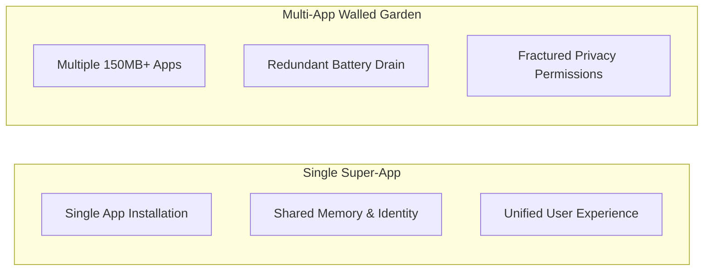

# 04 — FEATURE ADVANTAGES, DISADVANTAGES & TRADE-OFFS

An honest, architectural evaluation of the benefits, technical debts, trade-offs, and operational realities across SUPER_AI's primary modules.

---

## 1. Module-by-Module Trade-Off Matrix

### 1.1 Realtime Encrypted Chat & Messaging
- **User Advantages:** Instant reachability; seamless sharing of products, posts, and food items directly within conversation threads.
- **Technical Advantages:** Minimal latency over WebSockets; server-side AES-256-GCM envelope encryption prevents database-level plaintext snooping.
- **Disadvantages & Trade-offs:** Server-side encryption is **not End-to-End Encryption (E2EE)**. The server holds the transient decryption key in memory, making it vulnerable to hostile memory inspection if the host OS is compromised.
- **What Specialists Do Better:** Signal and WhatsApp provide true client-side E2EE (Signal Protocol) with Double Ratchet key exchange and forward secrecy.
- **Required SUPER_AI Improvement:** Implement client-side key generation using Web Crypto API to transition from envelope encryption to true zero-knowledge E2EE.

### 1.2 Social Network & Video Streaming
- **User Advantages:** High-velocity content consumption and community discovery unified with commerce.
- **Technical Advantages:** Direct integration with universal search and merchant catalogs; responsive HLS-compatible playback.
- **Disadvantages & Trade-offs:** Video transcoding and hosting require massive multi-terabyte storage and bandwidth scaling.
- **What Specialists Do Better:** YouTube and Instagram Reels employ sophisticated edge transcoding pipelines (AV1/VP9 adaptive bitrate) and planetary multi-tiered CDNs.
- **Required SUPER_AI Improvement:** Integrate an S3-compatible object store (MinIO or Cloudflare R2) backed by distributed edge transcoders rather than single-node volume mounting.

### 1.3 Zaviro E-Commerce & Food Ordering
- **User Advantages:** Single checkout experience; integer-paise pricing precision eliminates unexpected rounding errors; cross-cart item sharing.
- **Technical Advantages:** Atomic conditional inventory decrements (`$inc`, `$gte`) prevent stock overselling; strict BOLA boundaries protect customer privacy.
- **Disadvantages & Trade-offs:** Catalog depth is currently modest compared to hyper-scale marketplaces; logistics tracking relies on simulated milestone updates.
- **What Specialists Do Better:** Amazon and Swiggy operate complex automated delivery dispatch engines with real-time GPS tracking of hundreds of thousands of couriers.
- **Required SUPER_AI Improvement:** Integrate real-time third-party logistics APIs (e.g., Shiprocket, Dunzo for Business) for live GPS driver telematics.

### 1.4 Native 23-Language Localization
- **User Advantages:** Unmatched linguistic equity across all 22 Eighth Schedule Indian languages + English, with script-accurate typography and RTL support for Urdu, Kashmiri, and Sindhi.
- **Technical Advantages:** Zero runtime AI hallucination; zero latency impact; lightweight dictionary structure; strict ISO 639 code validation.
- **Disadvantages & Trade-offs:** Requires manual localization dictionary updates for newly introduced phrases rather than dynamic on-the-fly translation.
- **What Specialists Do Better:** Specialist browser translation extensions translate dynamic user-generated content in real time (though often with comedic grammatical errors).
- **Required SUPER_AI Improvement:** Implement crowd-sourced localization validation tools for community contributors to expand vocabulary coverage.

### 1.5 Private Audit Ledger & Blockchain Anchoring
- **User Advantages:** Mathematically verifiable evidence of transaction events; independent auditing prevents hidden tampering.
- **Technical Advantages:** RFC 8785 Canonical JSON ensures bit-for-bit reproducible SHA-256 hashes; zero PII leakage on-chain.
- **Disadvantages & Trade-offs:** Audit ledger writes introduce minor storage amplification; public blockchain anchoring introduces latency and gas management complexity.
- **What Specialists Do Better:** Dedicated enterprise audit platforms (e.g., QLDB, Hyperledger Fabric) provide out-of-the-box consensus nodes.
- **Required SUPER_AI Improvement:** Automate scheduled batch anchoring with L2 rollup integration (Polygon or Arbitrum) to minimize gas overheads.

---

## 2. Macro Architecture Comparison

| Evaluation Criteria | Unified SUPER_AI Platform | Multi-App Specialist Ecosystem | Hybrid Model |
| :--- | :--- | :--- | :--- |
| **System Resource Efficiency** | **High (single runtime, shared cache)** | Low (multiple daemons running) | Moderate |
| **Developer Maintenance Cost** | **Lower (single codebase & pipeline)** | High (multiple disparate codebases)| High |
| **User Convenience** | **High (zero app-switching)** | Low (constant app-switching) | Moderate |
| **Resilience to Single Outage**| Moderate (core service failure affects all)| **High (isolated failure per app)** | High |
| **Time to Market for New Features**| **Fast (reusable identity & UI components)**| Slow (requires full separate stack)| Moderate |

---

## 3. Conclusion on Trade-Offs
SUPER_AI's unified architecture provides significant advantages in **resource conservation, data sovereignty, linguistic inclusivity, and unified user journeys**. Its primary trade-offs—such as server-side encryption vs. E2EE, and simulated logistics vs. physical delivery fleets—are conscious engineering decisions tailored to creating a clean, verifiable, sovereign foundation ready for controlled staging.
