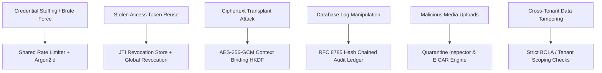

# 07 — SECURITY & PRIVACY SPECIFICATION

A comprehensive analysis of SUPER_AI's security defenses, cryptographic guarantees, threat model, and verified privacy controls.

---

## 1. Security Architecture & Threat Model

SUPER_AI is engineered under the principle of **Defense in Depth**, addressing major threat vectors identified during the Phase 7 Threat Model:

---

## 2. Cryptographic Security & Privacy Controls

### 2.1 Password Hashing & Authentication
- **Algorithm:** Argon2id (Memory cost: 65,536 KiB, Time cost: 3 iterations, Parallelism: 4 threads).
- **Token Design:** Stateless JSON Web Tokens (JWT) signed with HMAC-SHA256 containing a unique UUID `jti` (JWT ID).
- **Instant Revocation:** Upon calling `POST /auth/logout`, the `jti` is pushed to an in-memory/Redis blacklist with TTL matching token expiry.

### 2.2 Envelope Encryption at Rest
- Sensitive database fields (such as chat message contents) are protected via AES-256-GCM.
- **Context Binding:** Derives document-specific keys using HKDF-SHA256 parameterized with `entity_type` (e.g., `chat`) and `entity_id` (e.g., `conversation_id`).
- Moving ciphertext between documents renders it undecryptable, preventing tampering and field transplantation.

### 2.3 Immutable Private Audit Ledger
- **Canonical Serialization:** Adheres strictly to RFC 8785 JSON Canonicalization Scheme (JCS).
- **Chaining:** Consecutive records are cryptographically bound via SHA-256. If a row is modified, deleted, inserted, or reordered, the chain is broken immediately.
- **Privacy Assurance:** Zero PII on-chain or in ledger payloads. User IDs are pseudonymized using HMAC-SHA256 with a secret server salt.

### 2.4 Device Identity & Challenge-Response
- Devices register an Ed25519 public key.
- Sensitive administrative workflows trigger a cryptographic challenge containing a random nonce and a 300-second expiration.
- Replay attacks are mitigated by invalidating nonces upon single use.

---

## 3. Marketplace & Transaction Integrity (Phase 13 Hardening)

1. **Integer-Paise Currency Math:**
   - Float values are forbidden in order calculations.
   - Calculations use 64-bit integer paise (`100 paise = 1 INR`). Subtotals, shipping rates, and 18% GST are calculated server-side, preventing penny-rounding manipulation.

2. **Atomic Inventory Reservation:**
   - Product stock decrements use conditional atomic updates:
     `db.products.update_one({"_id": id, "stock": {"$gte": qty}}, {"$inc": {"stock": -qty}})`
   - Cancellations restore stock atomically.

3. **Broken Object-Level Authorization (BOLA) Defense:**
   - Order queries strictly require authenticated ownership: `{"_id": order_id, "user_id": current_user["_id"]}`.
   - Cross-tenant requests receive `404 Not Found` to prevent account enumeration.

4. **Simulated Payment Sandbox Boundary:**
   - Payment endpoints explicitly reject client-submitted "paid" statuses.
   - All transactions carry `"simulated": true` flags and enforce `Idempotency-Key` headers to protect against network retry duplicates.

---

## 4. Operational Runbook & Disaster Recovery

### 4.1 Master Key Rotation Procedure
If `ENCRYPTION_MASTER_KEY_V1` is suspect:
1. Generate a new 256-bit base64 secret as `ENCRYPTION_MASTER_KEY_V2`.
2. Configure `CURRENT_KEY_VERSION=v2` in the environment.
3. Restart workers; existing records decrypt via `v1` and new writes use `v2`.
4. Trigger the background re-encryption worker to migrate legacy rows.

### 4.2 Audit Ledger Tampering Response
If `backend/verify_ledger.py` detects a hash mismatch:
1. Isolate the affected database replica immediately.
2. Cross-reference the last signed Ed25519 checkpoint to pinpoint the sequence divergence.
3. Restore the verified state from write-ahead transaction logs up to the verified checkpoint.
