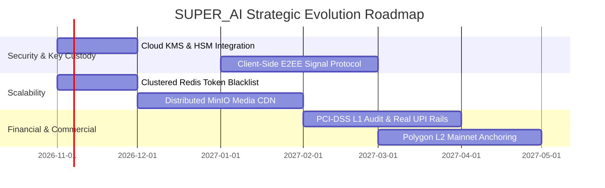

# 10 — LIMITATIONS & FUTURE ROADMAP

A transparent account of current system limitations, architectural trade-offs, and the strategic technical roadmap for Phase 15 and beyond.

---

## 1. Known Current Limitations

1. **Simulated Financial Rails:**
   - The payment gateway simulates UPI VPA resolution, card tokenization, and netbanking responses in-memory/MongoDB. No live banking APIs (NPCI, Stripe, Razorpay) are connected.
   - Live commercial deployment requires formal Payment Aggregator (PA) licensing and PCI-DSS Level 1 certification.

2. **Server-Side Encryption vs. E2EE:**
   - Sensitive chat messages are encrypted at rest via AES-256-GCM on the application server. While this completely isolates database storage from dump leaks, it is **not End-to-End Encryption (E2EE)** because the server processes plaintexts in transient memory.

3. **Single-Node Master Key Custody:**
   - Master encryption keys (`ENCRYPTION_MASTER_KEY_V1/V2`) reside in environment variables rather than a dedicated Hardware Security Module (HSM) or Cloud KMS (Google Cloud KMS / AWS KMS).

4. **Simulated EVM Blockchain Node:**
   - While the smart contract `SuperAIAuditLedgerAnchor.sol` compiles and verifies cryptographically against Hardhat/SimulatedEVM, it is not deployed to Ethereum or Polygon Mainnet.

5. **Android Signing Configuration:**
   - The compiled Android package (`app-debug.apk`) is signed with the standard Android debug certificate. Production Play Store distribution requires an offline hardware-backed release keystore.

---

## 2. Strategic Engineering Roadmap

### Phase 15: Enterprise Cloud Hardening & Distributed Caching
- Connect `backend/app/services/rate_limiter.py` and `token_blacklist.py` to an authenticated multi-region Redis cluster.
- Migrate envelope encryption root keys from environment variables to Google Cloud KMS or AWS KMS with automated 90-day rotation.

### Phase 16: Zero-Knowledge Client E2EE
- Implement Web Crypto API (SubtleCrypto) client-side key generation.
- Deploy the Double Ratchet Algorithm (Signal Protocol) to ensure zero server-side plaintext visibility for private messaging.

### Phase 17: Commercial Logistics & Live Payments
- Complete PCI-DSS Level 1 audit.
- Integrate NPCI UPI 2.0 intent flows and RuPay 3D-Secure 2.0 payment aggregators.
- Integrate third-party logistics APIs (e.g., Shiprocket) for automated courier allocation and live GPS tracking.

### Phase 18: Public Layer-2 Blockchain Anchoring
- Deploy `SuperAIAuditLedgerAnchor.sol` to Polygon Amoy Testnet and subsequently to Polygon PoS Mainnet.
- Automate multi-sig sponsored gas transactions for daily checkpoint anchoring.
