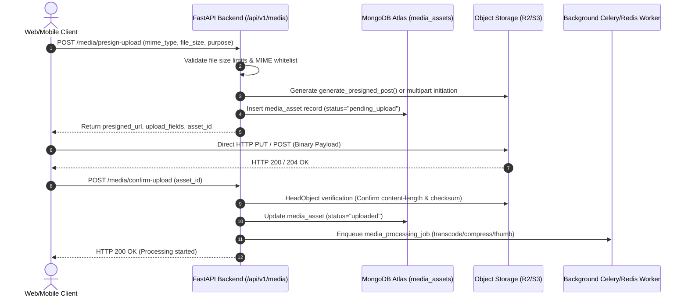

# ZYNOVA 3.0 — PHASE 24: MEDIA INFRASTRUCTURE ARCHITECTURE
**Document ID:** DOC-PHASE24-MEDIA-001  
**Author:** Principal Backend Architect & Distributed Systems Engineer  
**Status:** Approved Architecture Specification  
**Scope:** Unified Storage, Presigned Ingestion, Transcoding, & CDN Distribution for Social, Connect & Video  

---

## 1. EXECUTIVE SUMMARY & DESIGN PHILOSOPHY

The Zynova ecosystem combines three high-throughput media consumers:
1. **Zynova Social**: High-volume, losslessly compressed square/portrait photos, carousels, and 9:16 short-form video reels.
2. **Zynova Connect**: Low-latency, end-to-end encrypted or privacy-isolated chat attachments (images, voice notes, video clips, documents) and ephemeral 24-hour status stories.
3. **Zynova Video**: High-bitrate 16:9 landscape video uploads up to 2GB, requiring multi-rendition HLS transcoding, video thumbnail extraction, and adaptive streaming distribution.

### Core Architectural Principles
- **Zero Media Through Backend App Servers**: Application servers running FastAPI must **never** proxy large binary payloads into memory or local disk in production. All uploads flow directly from clients to S3-compatible Object Storage (Cloudflare R2 / AWS S3) via cryptographically signed presigned URLs.
- **Strict Multipart Ingestion & Resumability**: Video and large document uploads (>100MB) must leverage AWS S3 S3-compatible Multipart Upload protocol to support chunk-level pausing, resuming, and network fault tolerance.
- **Security-First Media Gatekeeping**: Prior to public CDN access, media assets pass through automated malware inspection, MIME-type magic byte verification, and content-moderation hooks.
- **Content Delivery Network (CDN) Caching**: Edge delivery is cached via Cloudflare CDN with signed cookie/token capabilities for private chat attachments.

---

## 2. UNIFIED STORAGE TOPOLOGY (CLOUDFLARE R2 / AWS S3)

Zynova standardizes on S3-compliant object storage with dual-tier storage buckets to maximize egress efficiency and enforce privacy boundaries:

### 2.1 Bucket Segregation Matrix

| Bucket Identifier | Purpose | Access Control | CDN Optimization |
| :--- | :--- | :--- | :--- |
| `zynova-public-media` | Social posts, reels, video renditions, creator avatars, video thumbnails. | Public Read via CDN Edge | Cloudflare Edge Cache (Cache-Control: public, max-age=31536000, immutable) |
| `zynova-private-attachments` | Connect 1:1 chat media, group attachments, private voice notes, raw unedited video masters. | Private / Authenticated Signed URL / Token Access | Signed Cookie / Short-lived Presigned Edge Token (TTL = 300s) |
| `zynova-ephemeral-media` | Social stories, Connect status updates (24h lifespan). | Public Read via Edge / TTL Lifecycle Rules | Auto-deletion via Object Storage Lifecycle Policy (Expiration: 1 day) |

### 2.2 Storage Key Path Convention

```
zynova-public-media/
├── avatars/{user_id}/{timestamp}_{uuid4}.webp
├── social/
│   ├── posts/{post_id}/{uuid4}.webp
│   └── reels/{reel_id}/{uuid4}.mp4
├── video/
│   ├── thumbnails/{video_id}/{uuid4}.webp
│   └── hls/{video_id}/
│       ├── master.m3u8
│       ├── 1080p/
│       │   ├── stream.m3u8
│       │   └── segment_000.ts
│       ├── 720p/...
│       ├── 480p/...
│       └── 360p/...
└── ephemeral/
    └── stories/{user_id}/{story_id}_{uuid4}.webp

zynova-private-attachments/
└── connect/
    ├── chats/{conversation_id}/{year}/{month}/{uuid4}.bin (Client E2EE encrypted)
    └── voice/{conversation_id}/{uuid4}.aac
```

---

## 3. PRESIGNED UPLOAD WORKFLOW & LIFECYCLE

Direct-to-storage upload prevents saturation of FastAPI event loops and memory starvation.



### 3.1 Media Quotas and Constraints

| Purpose | Permitted MIME Types | Max File Size | Target Optimization |
| :--- | :--- | :--- | :--- |
| **User Avatar** | `image/jpeg`, `image/png`, `image/webp` | 5 MB | Transcoded to 400x400 WebP (85% quality) |
| **Social Photo** | `image/jpeg`, `image/png`, `image/webp`, `image/avif` | 15 MB | Responsive renditions (1080w, 720w, 360w WebP) |
| **Social Reel** | `video/mp4`, `video/quicktime` | 100 MB | Fast-start MP4 (H.264 / AAC), max 60s, 1080x1920 |
| **Connect Voice Note**| `audio/aac`, `audio/mp4`, `audio/ogg`, `audio/webm` | 20 MB | Converted to Opus / AAC (32 kbps mono) |
| **Connect Attachment**| Image, Audio, PDF, ZIP, DOCX | 50 MB | Stored as opaque encrypted/raw binary |
| **Video Platform** | `video/mp4`, `video/quicktime`, `video/mkv`, `video/webm`| 2,048 MB (2 GB) | Full HLS Multi-bitrate Adaptive Bitrate Ladder |

---

## 4. VIDEO TRANSCODING & HLS PIPELINE

For Zynova Video (`video_catalog`), raw video files uploaded by creators must be transcoded asynchronously into HTTP Live Streaming (HLS) formats.

### 4.1 Transcoding Architecture

FastAPI dispatches an asynchronous task to a dedicated transcode worker container equipped with **FFmpeg hardware acceleration (NVENC / QuickSync) or CPU libx264**.

```
[Master Video MP4/MOV]
         │
         ▼
[FFmpeg Transcoding Pipeline]
         ├── 1080p (1920x1080 @ 4.5 Mbps) -> H.264 High Profile, AAC 192k
         ├── 720p  (1280x720  @ 2.4 Mbps) -> H.264 Main Profile, AAC 128k
         ├── 480p  (854x480   @ 1.2 Mbps) -> H.264 Main Profile, AAC 96k
         ├── 360p  (640x360   @ 600 kbps) -> H.264 Baseline, AAC 64k
         └── Sprite Sheet / Poster Thumbnails -> WebP (every 2s at 160x90)
         │
         ▼
[HLS Packager] -> master.m3u8 + variant playlists + .ts segments (4-second GOP)
         │
         ▼
[Storage Upload] -> zynova-public-media/video/hls/{video_id}/
```

### 4.2 Standard FFmpeg Command Construction for HLS Renditions
```bash
ffmpeg -i input_master.mp4 \
  -filter_complex \
  "[0:v]split=4[v1][v2][v3][v4]; \
   [v1]scale=w=1920:h=1080[v1out]; \
   [v2]scale=w=1280:h=720[v2out]; \
   [v3]scale=w=854:h=480[v3out]; \
   [v4]scale=w=640:h=360[v4out]" \
  -map "[v1out]" -c:v:0 libx264 -b:v:0 4500k -maxrate:v:0 4800k -bufsize:v:0 9000k \
  -map "[v2out]" -c:v:1 libx264 -b:v:1 2400k -maxrate:v:1 2600k -bufsize:v:1 4800k \
  -map "[v3out]" -c:v:2 libx264 -b:v:2 1200k -maxrate:v:2 1400k -bufsize:v:2 2400k \
  -map "[v4out]" -c:v:3 libx264 -b:v:3 600k  -maxrate:v:3 700k  -bufsize:v:3 1200k \
  -map a:0 -c:a:0 aac -b:a:0 192k \
  -map a:0 -c:a:1 aac -b:a:1 128k \
  -map a:0 -c:a:2 aac -b:a:2 96k \
  -map a:0 -c:a:3 aac -b:a:3 64k \
  -f hls -hls_time 4 -hls_playlist_type vod \
  -hls_flags independent_segments \
  -master_pl_name master.m3u8 \
  -var_stream_map "v:0,a:0 v:1,a:1 v:2,a:2 v:3,a:3" \
  output_%v.m3u8
```

---

## 5. MALWARE SCANNING & VALIDATION INTEGRATION

The existing Zynova security scanner (`backend/app/services/scanner.py`) incorporates EICAR signature detection. In Phase 24, this is extended into a non-blocking asynchronous verification step:

1. **Magic Number Inspection**: Validate first 16 bytes of every confirmed upload against expected magic signatures (e.g. `FF D8 FF` for JPEG, `89 50 4E 47` for PNG, `00 00 00 18 66 74 79 70` for MP4). Reject mismatches immediately.
2. **Streaming Anti-Malware Scan**: The background worker downloads the first 1MB and executes stream analysis against ClamAV / YARA rules / EICAR signatures.
3. **Quarantine Logic**: If malicious payloads or file header spoofing are discovered:
   - Object is immediately deleted or moved to `zynova-quarantine/`.
   - `media_assets` collection record status updated to `"quarantined"`.
   - Security audit event logged via `ed25519_audit_log`.
   - User account flagged for security review.

---

## 6. CDN CACHING & PRIVATE MEDIA GATEWAY

- **Public Media (Social & Video)**:
  - Base URL: `https://cdn.intellidev.in/public/...`
  - Cache-Control: `public, max-age=31536000, immutable` for hashed files.
  - Byte-Range Requests: Supported for video streaming seeking (`HTTP 206 Partial Content`).
- **Private Connect Media**:
  - Base URL: `https://cdn.intellidev.in/secure/...`
  - Served via Cloudflare Signed URLs or token authorization validated at Cloudflare Workers edge.
  - Tokens expire after 300 seconds and are signed using Ed25519 or HMAC-SHA256 with keys stored in backend secrets.
